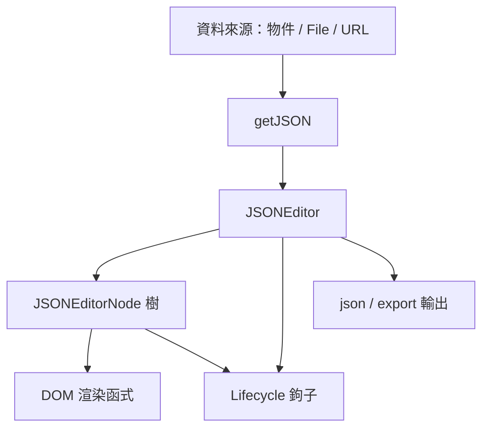

> [!NOTE]
> 此 README 由 [SKILL](https://github.com/agenvoy/skill-readme-generate) 生成，英文版請參閱 [這裡](../README.md)。

***

<strong>A LIGHTWEIGHT VISUAL JSON EDITOR BUILT WITH PURE JAVASCRIPT</strong>

***

> 零依賴的純 JavaScript 視覺化 JSON 編輯器，支援樹狀編輯、逐節點型別切換與生命週期鉤子

## 目錄

- [功能特點](#功能特點)
- [架構](#架構)
- [授權](#授權)
- [Author](#author)

## 功能特點

> `npm install @pardnchiu/nanojson` · [完整文件](./doc.zh.md)

- **零依賴視覺化樹狀編輯** — 以純 JavaScript 與原生 DOM API 建構的 JSON 樹狀編輯器，不需任何前端框架即可嵌入頁面。
- **逐節點型別切換** — 每個節點可即時在 string／number／boolean／object／array 間切換，只重建該節點的子樹而非整棵樹。
- **可取消的生命週期鉤子** — `before*` 鉤子回傳 `false` 即可攔截渲染或更新，連續輸入以 300ms 防抖合併為單次更新。
- **三種資料來源與內建檔案操作** — 初始資料可為 JavaScript 物件、File 物件或 URL，並內建開啟、下載與重置按鈕。
- **執行期唯讀切換** — 以 `enable()`／`disable()` 隨時切換唯讀狀態，唯讀時節點仍可展開與收合。

## 架構

> [完整架構](./architecture.zh.md)

## 授權

本專案採用 [MIT LICENSE](../LICENSE)。

## Author

Just [open an issue](https://github.com/pardnchiu/NanoJSON/issues/new) to share an idea.

***

©️ 2025 [邱敬幃 Pardn Chiu](https://www.linkedin.com/in/pardnchiu)
