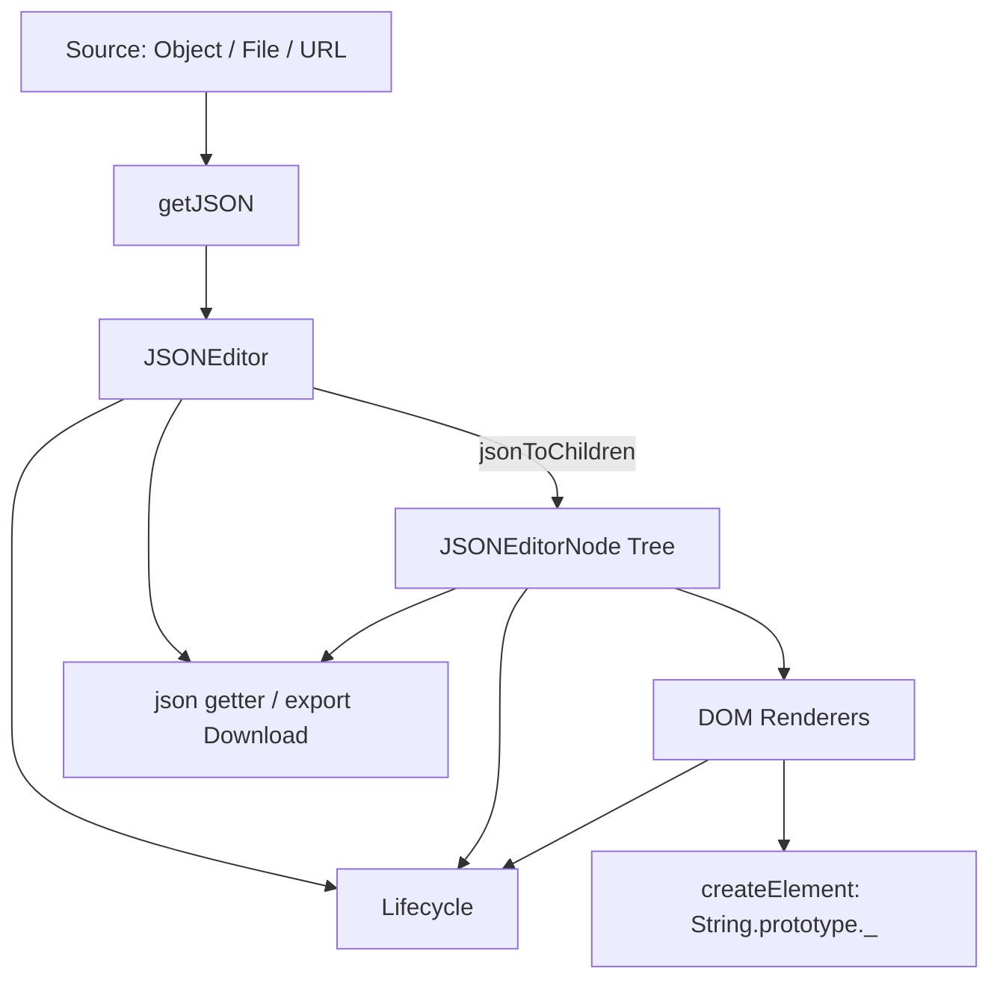
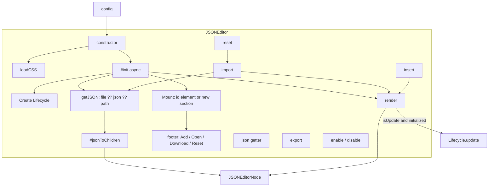
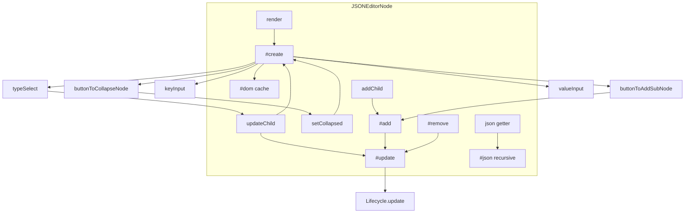
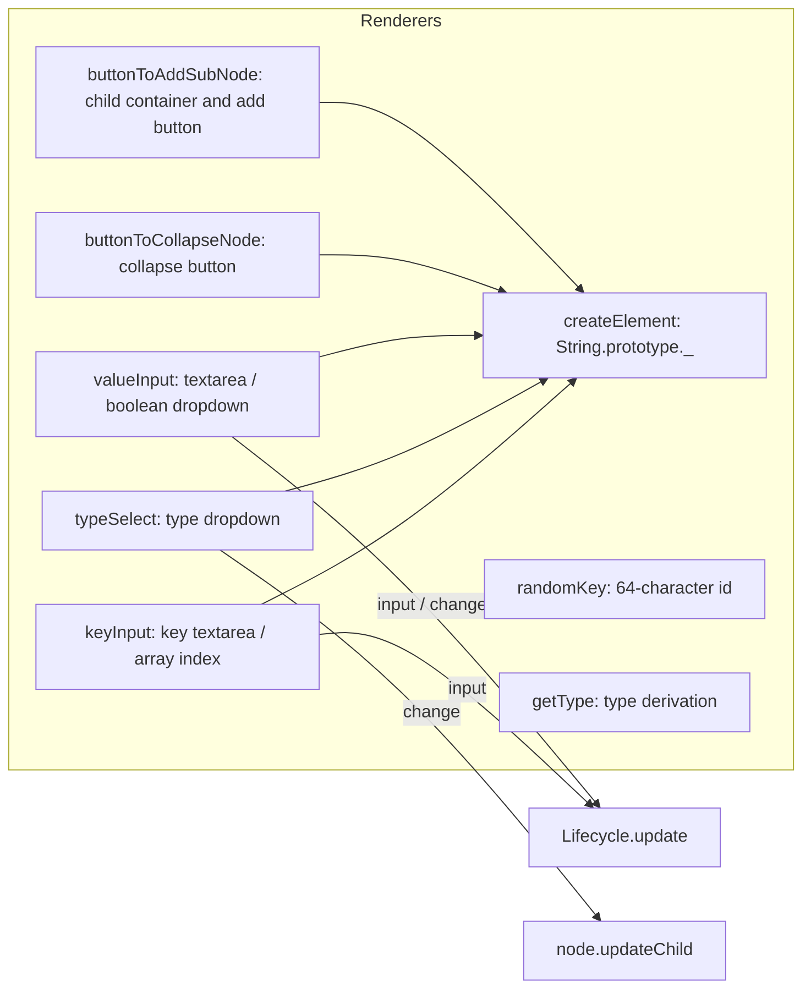
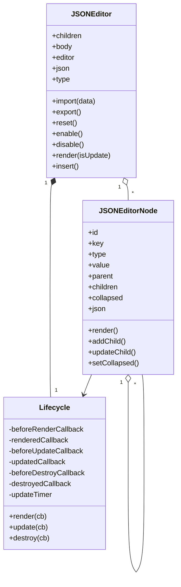
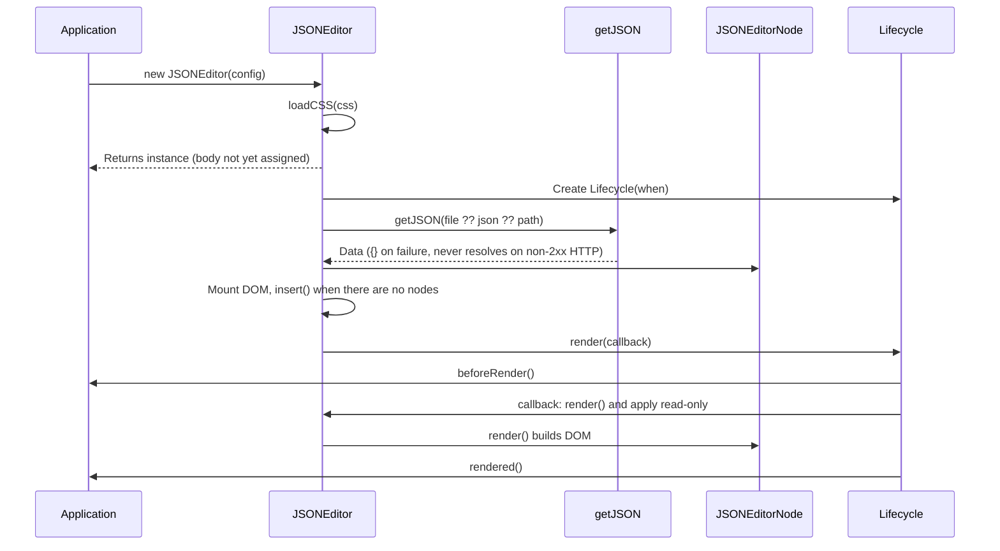
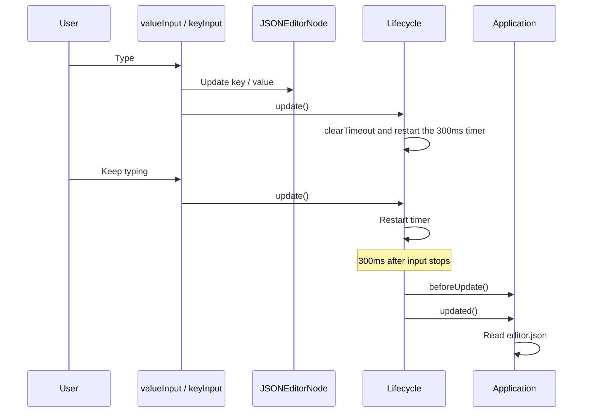
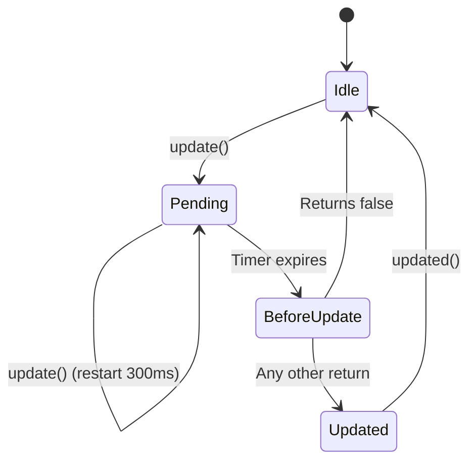
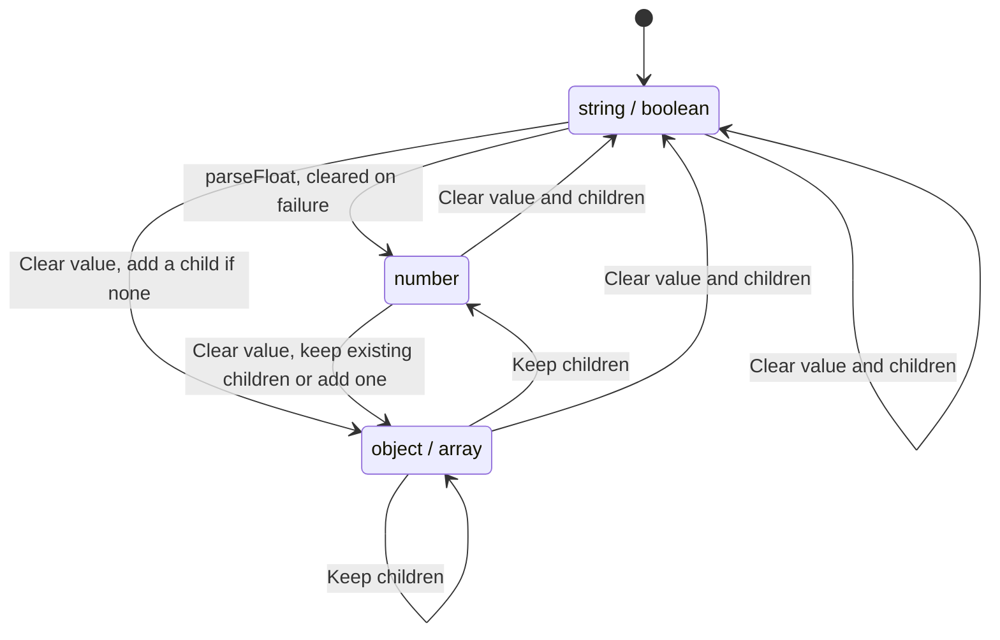

# nanojson - Architecture

> Back to [README](../README.md)

## Overview

## Module: JSONEditor

The root controller: loads config and styles, converts data into a node tree, mounts the DOM, and exposes the public import, export, and read-only methods.

## Module: JSONEditorNode

The recursive node: holds key / type / value / children, builds and caches its own DOM, and swaps only its subtree.

## Module: DOM Renderers

Stateless functions in `src/function/` that build each control of a single node.

## Module: Lifecycle

Manages the six hooks; a `before*` hook cancels by returning `false` synchronously, and updates are merged by a 300ms debounce.

## Data Flow

### Initialization

### Edit Update

## State Machine

### Update Debounce

### Node Type Switching

***

©️ 2025 [邱敬幃 Pardn Chiu](https://www.linkedin.com/in/pardnchiu)
