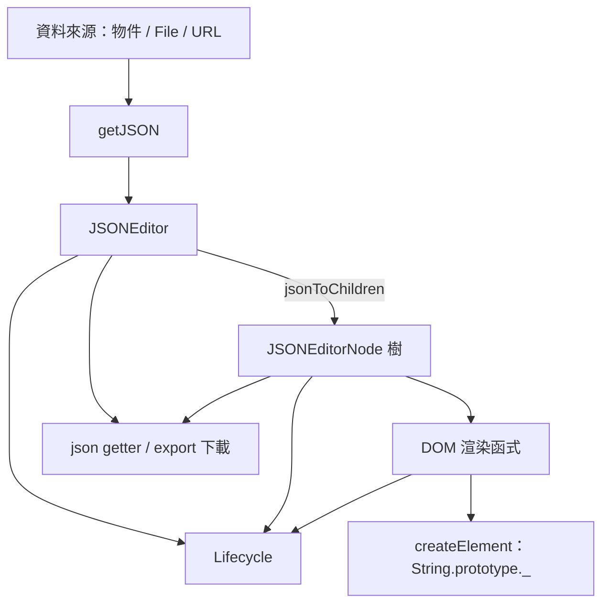
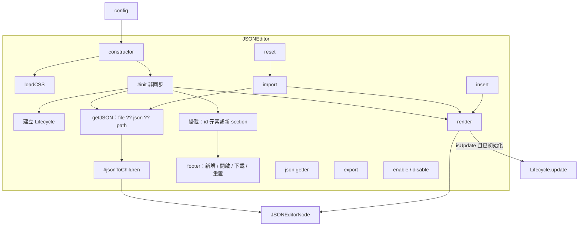
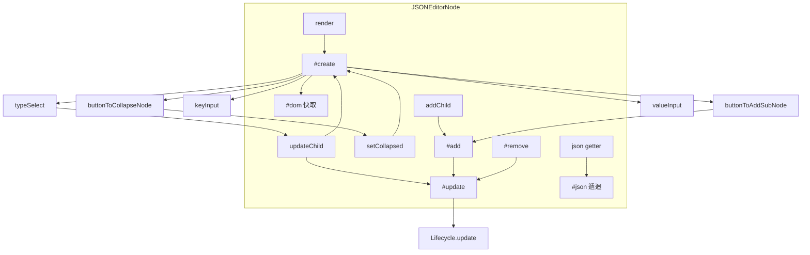
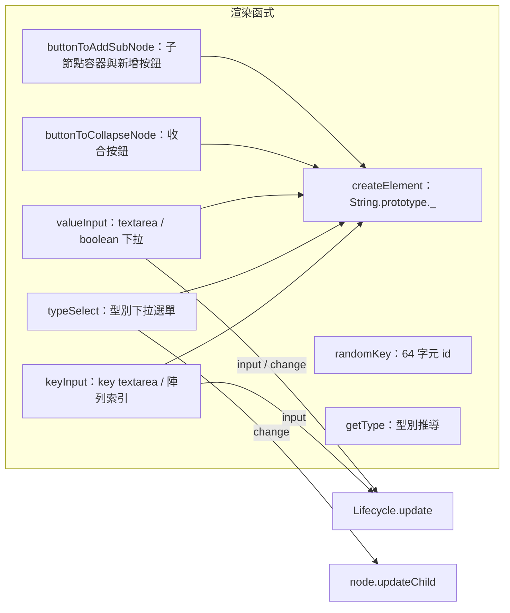
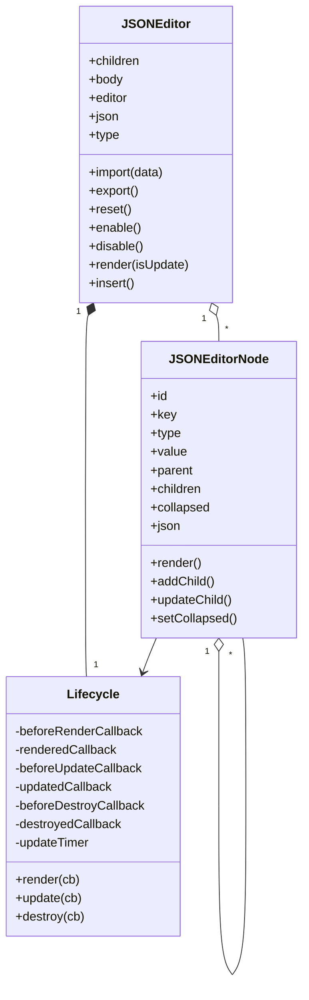
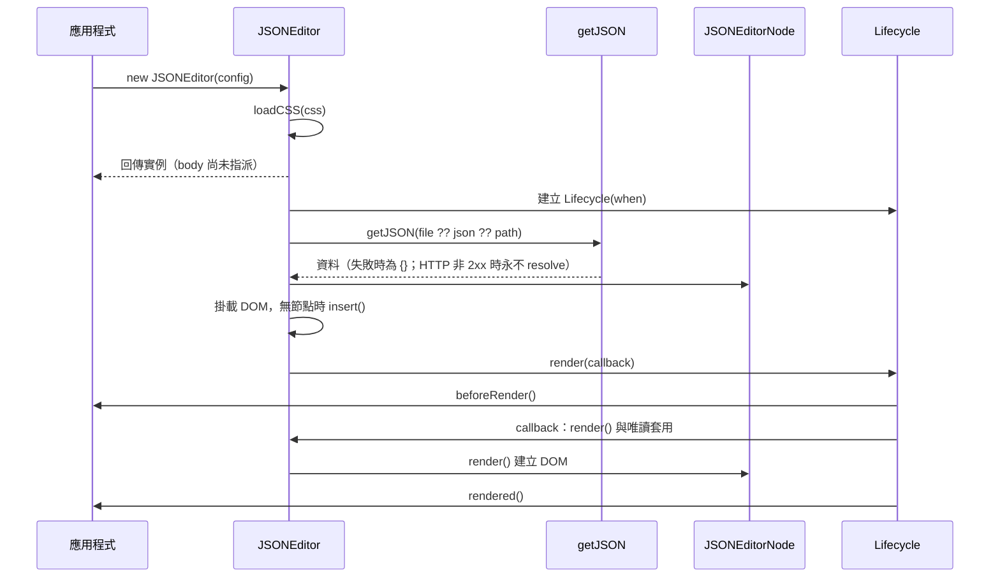
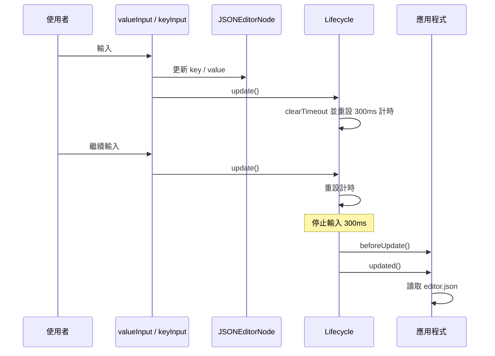
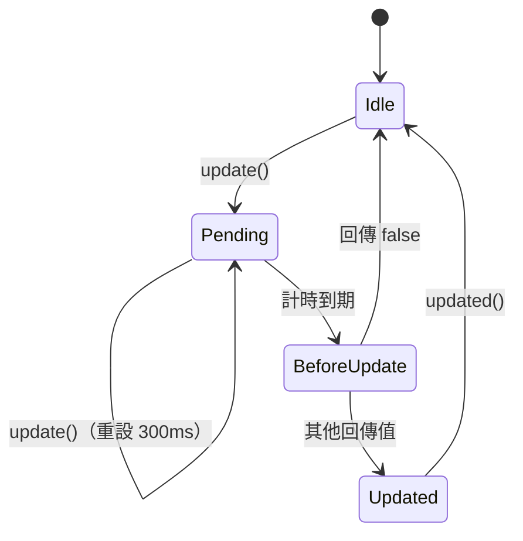
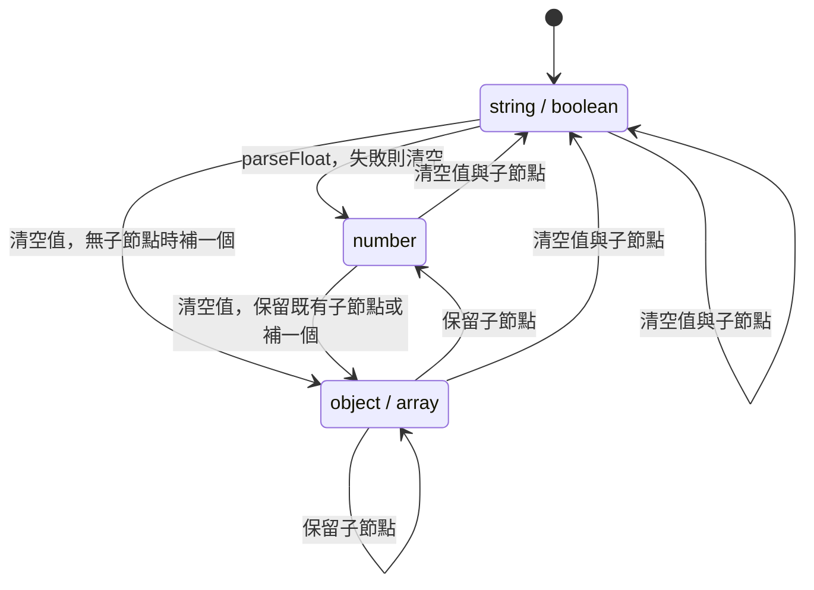

# nanojson - 架構

> 返回 [README](./README.zh.md)

## 概覽

## Module: JSONEditor

根控制器：載入設定與樣式、將資料轉為節點樹、掛載 DOM，並提供匯入、匯出、唯讀切換等公開方法。

## Module: JSONEditorNode

遞迴節點：持有 key／type／value／children，自行建立並快取 DOM，局部替換子樹。

## Module: DOM 渲染函式

`src/function/` 中的無狀態函式，負責產生單一節點的各個控制項。

## Module: Lifecycle

管理六個鉤子，`before*` 同步回傳 `false` 可取消，更新以 300ms 防抖合併。

## 資料流

### 初始化

### 編輯更新

## 狀態機

### 更新防抖

### 節點型別切換

***

©️ 2025 [邱敬幃 Pardn Chiu](https://www.linkedin.com/in/pardnchiu)
