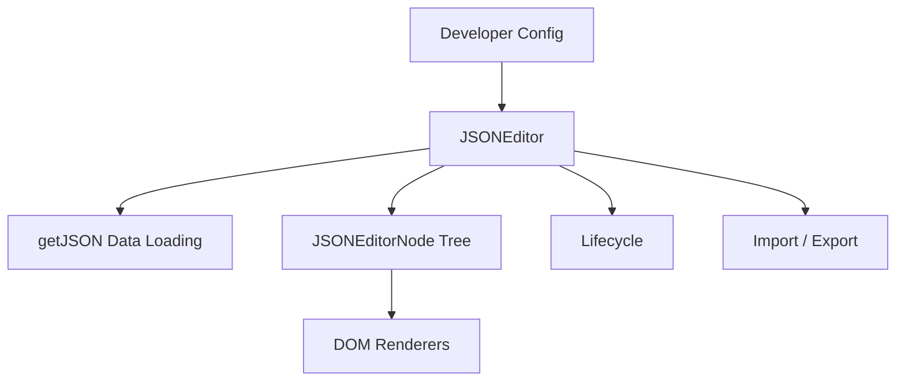

# Architecture

This page gives a system-level overview of NanoJSON. For per-module diagrams, the data-flow sequence diagram, and the lifecycle state machine, see the [full architecture document](https://github.com/pardnchiu/NanoJSON/blob/main/doc/architecture.md).

## Overview

## Layers

| Layer | Files | Responsibility |
|---|---|---|
| Entry point | `src/model/JSONEditor.js` | Mounts the DOM, loads initial data, coordinates import/export with the lifecycle |
| Data model | `src/model/JSONEditorNode.js` | Recursive node; holds key/type/value/children, handles local DOM re-render and serialization |
| Lifecycle | `src/model/Lifecycle.js` | Registers and fires the six hooks; `update()` carries a 300ms debounce |
| DOM renderers | `src/function/*.js` | `keyInput`, `valueInput`, `typeSelect`, `buttonToCollapseNode`, `buttonToAddSubNode`, etc., each owning one input region of a node's UI |
| Shared utilities | `src/data.js`, `src/function/createElement.js`, `getJSON.js`, `getType.js`, `randomKey.js` | `data.js` holds the string constant table (for minification), icon SVGs, and `loadCSS`; `createElement.js` defines the `String.prototype._` / `HTMLElement.prototype._` lightweight DOM-construction DSL; the rest load data, derive types, and generate node ids |

## Cross-Cutting Principles

- **No framework dependency**: all rendering goes through native `document.createElement` and the custom `String.prototype._()` DSL — no virtual DOM or framework runtime is involved
- **Scope among JSON editors**: `josdejong/jsoneditor` offers tree, code, text, and preview modes, with Ace-powered code editing and Ajv-powered JSON Schema validation; its successor `svelte-jsoneditor` lists JSON Editor Online as its homepage; `json-editor/json-editor` takes a JSON Schema and generates an HTML form; `vercel-labs/visual-json` is a schema-aware editor with React, Svelte, and Vue components. NanoJSON covers a single mode: tree editing of arbitrary JSON without a schema, with per-node type switching, shipped as a single script and stylesheet with no runtime dependencies
- **Local re-render first**: adding/removing a node only replaces the affected subtree (`JSONEditorNode.#add` / `#remove`), never the whole tree
- **Updates are always debounced**: any node data change goes through `Lifecycle.update()`'s 300ms debounce, avoiding a flood of `updated` callbacks during character-by-character input
- **Serialization paths diverge**: `editor.json` (getter) and `editor.export()` treat a keyless root child differently — see [Serialization](/core-concepts-serialization)

## Further Reading

- [Full Architecture Document](https://github.com/pardnchiu/NanoJSON/blob/main/doc/architecture.md) (per-module diagrams, data-flow sequence diagram)
- [Core Concepts](/core-concepts)
- [Lifecycle Hooks](/lifecycle-hooks)
