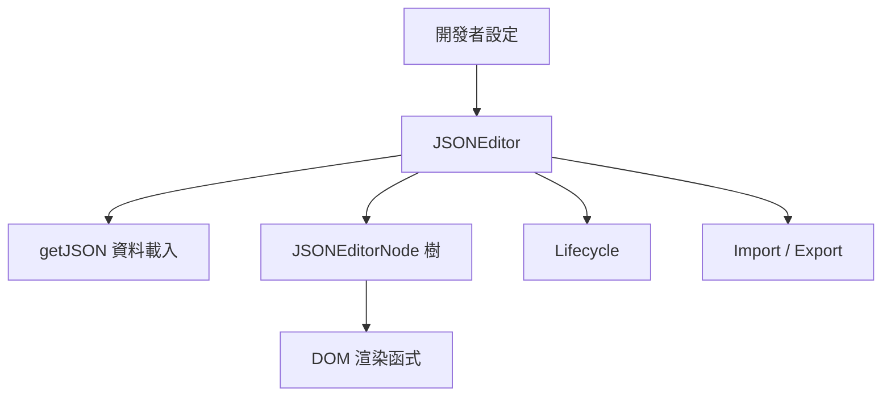

# 架構

本頁提供 NanoJSON 的系統層級概覽；模組內部結構、資料流時序圖與狀態機請見 [完整架構文件](https://github.com/pardnchiu/NanoJSON/blob/main/doc/architecture.zh.md)。

## 概覽

## 分層表

| 層 | 檔案 | 職責 |
|---|---|---|
| 進入點 | `src/model/JSONEditor.js` | 掛載 DOM、載入初始資料、協調匯入匯出與生命週期 |
| 資料模型 | `src/model/JSONEditorNode.js` | 遞迴節點；持有 key/type/value/children，負責局部 DOM 重繪與序列化 |
| 生命週期 | `src/model/Lifecycle.js` | 六個鉤子的註冊與觸發，`update()` 帶 300ms 防抖 |
| DOM 渲染函式 | `src/function/*.js` | `keyInput`、`valueInput`、`typeSelect`、`buttonToCollapseNode`、`buttonToAddSubNode` 等，各自負責節點 UI 的其中一個輸入區塊 |
| 共用工具 | `src/data.js`、`src/function/createElement.js`、`getJSON.js`、`getType.js`、`randomKey.js` | `data.js` 放字串常數表（供壓縮用）、icon SVG 與 `loadCSS`；`createElement.js` 定義 `String.prototype._` / `HTMLElement.prototype._` 這組輕量 DOM 建構 DSL；其餘負責載入資料、推導型別與產生節點 id |

## 跨切原則

- **無框架依賴**：所有渲染皆透過原生 `document.createElement` 與 `String.prototype._()` 這組自製 DSL 完成，不引入 Virtual DOM 或框架 runtime
- **在 JSON 編輯器中的範圍**：`josdejong/jsoneditor` 提供樹狀、程式碼、純文字與預覽模式，程式碼編輯由 Ace 提供、JSON Schema 驗證由 Ajv 提供；其後繼專案 `svelte-jsoneditor` 的首頁是 JSON Editor Online；`json-editor/json-editor` 依 JSON Schema 產生 HTML 表單；`vercel-labs/visual-json` 是支援 schema 的編輯器，提供 React、Svelte 與 Vue 元件。NanoJSON 只做一種模式：不需 schema 的任意 JSON 樹狀編輯與逐節點型別切換，以單一腳本與樣式表發佈、執行期沒有任何依賴
- **局部重繪優先**：新增／移除節點只替換受影響子樹（`JSONEditorNode.#add` / `#remove`），不會整棵樹重新渲染
- **更新一律防抖**：任何節點資料變動都經過 `Lifecycle.update()` 的 300ms 防抖，避免逐字輸入觸發大量 `updated` 回呼
- **序列化路徑分歧**：`editor.json`（getter）與 `editor.export()` 對「根層無鍵子節點」的處理不同，詳見 [序列化](/zh/core-concepts-serialization)

## 延伸閱讀

- [完整架構文件](https://github.com/pardnchiu/NanoJSON/blob/main/doc/architecture.zh.md)（模組級圖、資料流時序圖）
- [核心概念](/zh/core-concepts)
- [生命週期鉤子](/zh/lifecycle-hooks)
