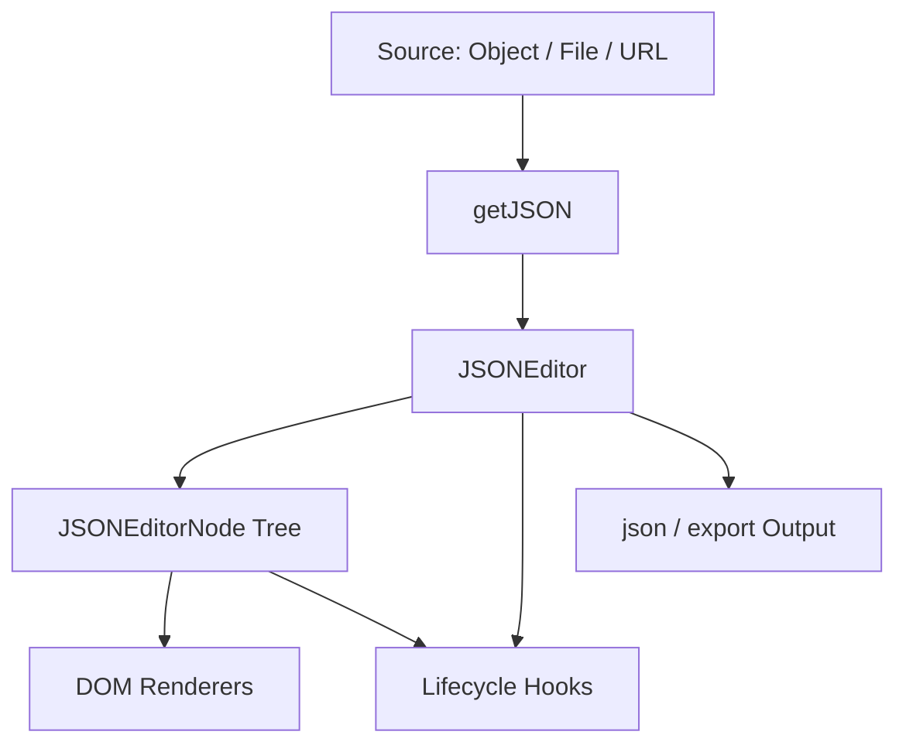

> [!NOTE]
> This README was generated by [SKILL](https://github.com/agenvoy/skill-readme-generate), get the ZH version from [here](https://github.com/pardnchiu/NanoJSON/blob/main/doc/README.zh.md).

***

<strong>A LIGHTWEIGHT VISUAL JSON EDITOR BUILT WITH PURE JAVASCRIPT</strong>

***

> A pure JavaScript JSON editor library with zero-dependency tree editing, per-node type switching, and cancelable lifecycle hooks

## Table of Contents

- [Features](#features)
- [Architecture](#architecture)
- [License](#license)
- [Author](#author)

## Features

> `npm install @pardnchiu/nanojson` · [Documentation](https://github.com/pardnchiu/NanoJSON/blob/main/doc/doc.md)

- **Zero-dependency tree editing** — A visual JSON tree editor built on pure JavaScript and native DOM APIs that embeds into any page without a frontend framework.
- **Per-node type switching** — Each node switches live between string / number / boolean / object / array, rebuilding only its own subtree instead of the whole tree.
- **Cancelable lifecycle hooks** — Returning `false` from a `before*` hook blocks the render or update, and continuous input collapses into a single update through a 300ms debounce.
- **Three data sources, built-in file actions** — Initial data comes from a JavaScript object, a File object, or a URL, with built-in Open, Download, and Reset buttons.
- **Runtime read-only toggle** — `enable()` / `disable()` switch read-only mode at any time, and nodes still expand and collapse while read-only.

## Architecture

> [Full Architecture](https://github.com/pardnchiu/NanoJSON/blob/main/doc/architecture.md)

## License

This project is licensed under the [MIT LICENSE](https://github.com/pardnchiu/NanoJSON/blob/main/LICENSE).

## Author

Just [open an issue](https://github.com/pardnchiu/NanoJSON/issues/new) to share an idea.

***

©️ 2025 [邱敬幃 Pardn Chiu](https://www.linkedin.com/in/pardnchiu)
